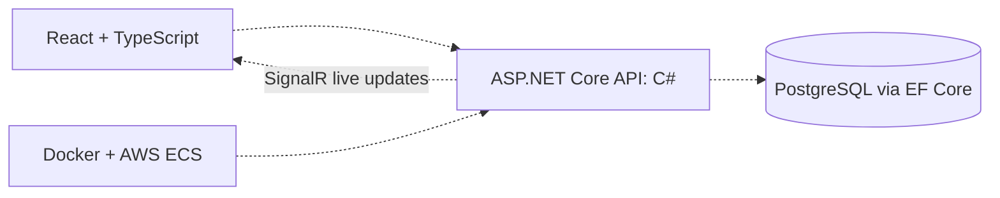

# Zinnia

Work Order Platform


## What's going on here

Zinnia is a work order and asset management platform. It's meant for teams that keep physical things running. Think of a crew with a list of jobs to do and a pile of equipment to keep track of.

This project is early. The backend skeleton is up and running, and the bigger features are still ahead. I've split this README into what works today and what's planned, so you know which is which.

- Named after the [fourth track](https://www.youtube.com/watch?v=IWqJMne8xbU) on Clairo's 2021 album *Sling*

## Who it's for

Zinnia is built for anyone who manages physical operations and the people doing the work.

- Construction crews coordinating projects
- Fleet teams managing vehicles and equipment
- Asset teams cataloging inventory and tracking where things are
- Maintenance teams scheduling work and logging history

## What works today

Right now, there's a small API that runs and answers.

- A health check at `GET /health` that replies `{"status":"healthy"}`
- Auto-generated API docs, which show up when you run in development
- CORS settings so a web frontend can talk to the API
- You can lock CORS to specific sites with `Cors:AllowedOrigins` in the settings
- If you leave that empty, any site is allowed, which is handy for local work
- The database packages (Entity Framework Core and PostgreSQL) are installed
- But there's no database model yet

## What's planned

None of this is built yet. It's where the project is headed.

- Work orders you can create, assign to people, and track
- Assets you can catalog across an organization
- A React and TypeScript frontend
- Live updates with SignalR, so screens refresh without a page reload
- Docker packaging
- Deployment to AWS ECS, with Terraform, GitHub Actions, and CloudWatch

## How it'll fit together

This is the plan, not what's running today.

```
Employee
    │
    ▼
React Website (TypeScript)
    │
    ▼
ASP.NET Core API (C#)
    │
    ▼
PostgreSQL Database

SignalR keeps screens updated in real-time
```

## Tech stack

- **Today:** C#, ASP.NET Core on .NET 10
- **Installed, not used yet:** Entity Framework Core and PostgreSQL (Npgsql)
- **Planned:** React, TypeScript, SignalR, Docker, AWS ECS, Terraform, GitHub Actions, CloudWatch

## Why these technologies

- **C# and ASP.NET Core** build fast, solid web APIs
- **Entity Framework Core** lets code work with database tables as objects (installed, not used yet)
- **PostgreSQL** is a reliable database for work orders and assets (planned)
- **React and TypeScript** will build the screens (planned)
- **SignalR** will push live updates to every screen (planned)
- **Docker** will package the app (planned)
- **AWS ECS** will run it in the cloud (planned)
- **Terraform** will set up the cloud from code (planned)
- **GitHub Actions** will test and deploy changes (planned)
- **CloudWatch** will watch for problems (planned)

Dotted lines are planned.



## Running it

You'll need the .NET 10 SDK. Then do this.

- Clone it with `git clone https://github.com/marlware/zinnia.git`
- Move into the folder with `cd zinnia`
- Start the API with `dotnet run --project Zinnia.Api`
- Check it with `curl http://localhost:5067/health`
- You should see `{"status":"healthy"}`

Once you start adding the database, you'll also want PostgreSQL. Node.js comes in with the frontend.

## Good to know

- The API listens on http://localhost:5067 (and https://localhost:7163 if you use the https profile)
- `Zinnia.Api/Zinnia.Api.http` has the health request ready to run from your editor
- The license is MIT
